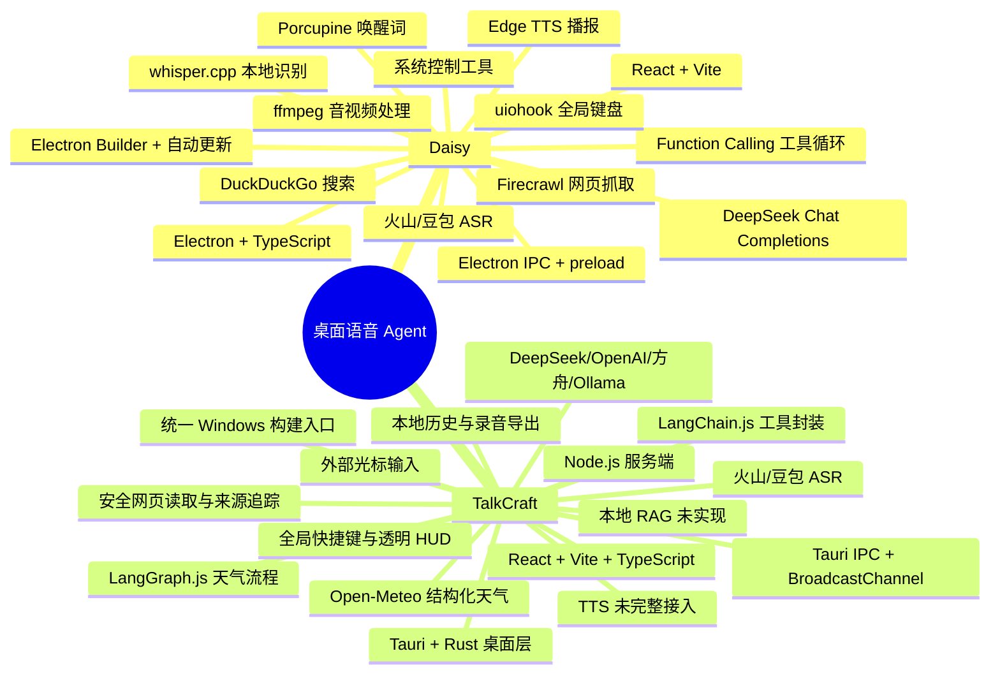
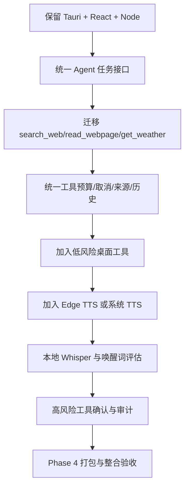

# Daisy 与 TalkCraft 技术栈对比

> 对比基准：Daisy-Voice-Agent Git 提交 `0a933f18b6ac3ea9e718ed306dd500d028968e1b`，版本 `1.6.0`，MIT 许可证。TalkCraft 为当前工作区实现，仍处于 Phase 1，尚未完成完整桌面验收。

## 一、技术全景

> 阅读方式：支持 Mermaid 的编辑器可直接渲染下方 `mindmap`；不支持 Mermaid 的思维导图软件可按本文标题层级导入，或使用 Markmap 等 Markdown 转思维导图工具打开。正文中的对比表和流程图用于补充决策细节。

### Markdown 思维导图兼容大纲

- 桌面语音 Agent
  - Daisy-Voice-Agent
    - Electron + TypeScript
    - React + Vite
    - DeepSeek 流式 Function Calling
    - DuckDuckGo / Firecrawl 搜索
    - 火山/豆包 ASR + whisper.cpp
    - Porcupine 唤醒词
    - Edge TTS
    - 系统控制工具
  - TalkCraft
    - Tauri + Rust
    - React + Vite + TypeScript
    - Node.js 服务端
    - LangChain.js + LangGraph.js
    - DeepSeek / OpenAI / 方舟 / Ollama
    - 火山/豆包 ASR
    - 搜索、网页读取、天气和来源追踪
    - 本地历史、录音导出、透明 HUD
    - ESP32-S3 / Wi-Fi 路线

## 二、技术栈对比表

| 层级 | Daisy | TalkCraft | 差异影响 |
|---|---|---|---|
| 桌面框架 | Electron | Tauri + Rust | Daisy 集成 Node 与系统 API 更直接；TalkCraft 安装体积和资源占用更有优势，但需要 Rust/Tauri IPC 边界 |
| 主语言 | TypeScript | Node.js JavaScript + React TypeScript + Rust | Daisy 类型边界更统一；TalkCraft 兼容现有 JS 服务和 Rust 桌面层 |
| 前端 | React、Vite、Framer Motion、Lucide | React、Vite、TypeScript、本地 HUD DOM/CSS | 两者都适合复杂状态 UI；TalkCraft 的 HUD 仍有原生回退实现 |
| 进程通信 | Electron preload/IPC | Tauri IPC、HTTP API、BroadcastChannel | TalkCraft 需要维护桌面端、Node 服务、React 工作台和 HUD 的多边界 |
| ASR | 火山/豆包 ASR；可选 whisper.cpp | 火山/豆包流式 ASR | Daisy 具备本地短指令备用；TalkCraft 当前侧重云端 ASR 与音频诊断 |
| 文字模型 | 以 DeepSeek 为主 | DeepSeek、OpenAI、方舟、Ollama | TalkCraft 提供器选择更多；Daisy 的单模型路径更容易深度调优 |
| Agent 编排 | DeepSeek 流式 Function Calling 自定义循环 | 旧搜索编排器 + LangChain 工具 + LangGraph 天气图 | Daisy 通用工具动作更完整；TalkCraft 的天气、来源、预算和取消审计更严格，但通用 Agent 迁移未完成 |
| 搜索 | DuckDuckGo；可选 Firecrawl | DeepSeek 原生搜索、网页读取器、Open-Meteo | TalkCraft 对来源和真实搜索证据区分更严格；Daisy 的搜索动作更直接 |
| 工具能力 | 应用、窗口、快捷键、文件、剪贴板、日历、提醒、媒体、网页 | 天气、搜索、读页、历史、外部输入 | Daisy 更接近系统控制 Agent；TalkCraft 更聚焦生产力输入和可追溯问答 |
| TTS | Edge TTS，支持队列和打断 | 尚未形成完整 TTS 主流程 | Daisy 是完整语音闭环；TalkCraft 目前主要输出文字 |
| 全局快捷键 | `uiohook-napi`、自定义监听器 | Tauri/Rust 快捷键与配置 | Daisy 直接依赖 Node 原生模块；TalkCraft 更依赖桌面桥接和 Windows 验证 |
| 唤醒词 | Porcupine，可选 Whisper | 未完成 | Daisy 支持免手操作；TalkCraft 目前以快捷键为主 |
| 音频处理 | ffmpeg-static | 浏览器录音、Web Audio、PCM/WAV 转换 | Daisy 适合多媒体处理；TalkCraft 适合浏览器/Tauri 录音链路和格式校验 |
| 持久化 | 本地 env、会话历史、日志 | 本机历史、录音、执行轨迹、配置文件 | TalkCraft 对原始转录、AI 结果、来源和音频生命周期拆分更细 |
| 打包更新 | electron-builder、electron-updater | Tauri 构建脚本；安装包留 Phase 4 | Daisy 产品化发行更成熟；TalkCraft 仍按开发版唯一 EXE 交付 |
| 许可证 | MIT，第三方依赖分别遵循各自许可证 | 自有代码与依赖按项目记录 | Daisy 可作为架构参考，不能直接复制代码而忽略依赖许可证 |

## 三、Daisy 为什么选择这套技术

### Electron

Daisy 的核心能力是让 Node.js 直接访问桌面系统：全局键盘监听、窗口、文件、剪贴板、应用进程、媒体和 TTS。Electron 把 Chromium、Node.js 和桌面窗口放在同一个应用模型中，减少了跨语言桥接代码。

优点：

- Node 生态可以直接使用 `uiohook-napi`、`ffmpeg-static`、文件和子进程 API；
- 主进程适合持续运行、托盘驻留和多窗口管理；
- React 渲染层与 Node 工具层连接路径短。

缺点：

- 包体积、内存和后台进程通常高于 Tauri；
- 原生 Node 模块带来 Windows/macOS ABI、打包和签名问题；
- Electron 的权限边界必须依靠 preload、IPC 白名单和严格输入校验维护。

### DeepSeek Function Calling 自定义循环

Daisy 需要连续完成“理解请求、调用工具、读取结果、继续行动、最终回答”，所以直接使用流式 Chat Completions 和工具调用循环，而不是把所有能力写成固定命令。

优点：

- 模型可以根据工具结果动态决定下一步；
- 搜索后可继续打开网页、读剪贴板或执行桌面动作；
- 流式响应能快速显示工具确认和回答。

缺点：

- 循环终止、重复调用、权限确认和副作用控制都要自己实现；
- 工具数量增加后，提示词和参数校验更难维护；
- 如果没有稳定的任务预算，模型可能重复执行动作。

TalkCraft 已有 LangChain/LangGraph、任务 ID、调用预算、取消和执行轨迹，适合把 Daisy 的通用循环逐步迁移进现有安全边界，而不是直接复制一个无限循环。

### 本地 Whisper 与云端 ASR 并存

Daisy 用 Whisper 处理唤醒词或短指令，用火山 ASR 处理主要语音会话，目的是在低延迟、离线能力和识别质量之间折中。

优点：

- 本地唤醒不必把每一秒环境音上传云端；
- 云端 ASR 对长句和中文普通话通常更稳定；
- 可以按场景选择速度、隐私或准确率。

缺点：

- 需要下载模型和随包携带本地二进制；
- Windows/macOS 的 CPU、模型文件和运行库兼容性更复杂；
- 两套 ASR 的结果、取消和错误状态需要统一。

TalkCraft 当前优先完成豆包 ASR 的热词、原始录音和真实准确率验收，再评估本地 Whisper，不应在没有实测模型资源前把它标成已具备能力。

### Edge TTS

Daisy 把最终回答转为语音，并支持播放队列、打断和 HUD 状态反馈，形成“说话输入、语音输出”的完整闭环。

优点：体验自然，适合免手操作；播放结果可分片合成，减少首字等待。

缺点：依赖网络和第三方服务；播报可能泄露回答内容；需要解决音频缓存、取消、重复播放和系统媒体键冲突。

## 四、TalkCraft 当前技术选择的理由

### Tauri + Rust

TalkCraft 已经有桌面窗口、透明 HUD、全局快捷键、外部光标注入和退出控制，因此保留 Tauri/Rust 可以降低当前迁移风险。

优点：

- 桌面包体积和资源占用通常更低；
- 系统窗口、透明区域和原生输入适合放在 Rust 边界；
- Node.js Agent 可以作为独立服务继续复用。

缺点：

- Rust 编译环境和 Windows SDK 是额外门槛；
- Node 与 Rust 之间需要明确 IPC、生命周期和错误传播；
- 直接复用 Daisy 的 Node 原生模块并不合适。

### React + Node.js

React 已用于工作台、历史、设置、执行过程和来源展示；Node.js 保留 ASR、文字模型和工具执行。

优点：

- UI 状态、事件流和窗口面板更容易拆分；
- 现有 `/api/agent`、历史和 ASR 接口可以保持兼容；
- 不需要为了前端迁移重写 Agent 和硬件路线。

缺点：

- React 工作台与原生 HUD 目前仍是两套 UI；
- Node 服务启动、退出和桌面 EXE 生命周期需要继续优化；
- 通用 Agent 仍处于旧编排器和 LangGraph 并存的迁移阶段。

### LangChain.js + LangGraph.js

TalkCraft 使用 LangChain 统一工具参数和模型适配，使用 LangGraph 管理已迁移的天气流程。

优点：

- 工具输入可以用结构化 schema 校验；
- 图节点适合表达理解、工具执行、证据检查、回答和取消；
- 后续可加入知识库检索和混合问题路由。

缺点：

- 框架不能自动解决搜索质量、来源可信度或实体识别；
- 如果旧循环、LangChain Agent 和 LangGraph 同时执行，可能重复付费；
- 迁移需要逐个验证取消、预算、历史兼容和副作用。

## 五、两者效果差距

| 目标效果 | Daisy 当前做法 | TalkCraft 当前状态 | 达成方式 |
|---|---|---|---|
| 按键说话并自动处理 | 全局按住快捷键，松开提交 | 已有快捷键和录音流程 | 保持现有协议，继续修复 ASR 质量 |
| 自动联网搜索 | 模型直接调用 `web_search`/`scrape_url` | 天气已进入 LangGraph，通用搜索仍旧编排 | 将通用搜索迁入单一 LangGraph 工具循环 |
| 结合搜索结果回答 | 工具结果回传 DeepSeek | 已有来源、摘要、正文和引用 | 保留现有证据门槛并迁移节点 |
| 控制桌面 | 多个系统工具 | 目前主要是光标输入和窗口控制 | 先增加低风险工具，再增加需确认的高风险工具 |
| 语音回答 | Edge TTS | 未完整接入 | 增加 TTS 服务、队列、打断和隐私设置 |
| 离线或弱网 | Whisper 备用 | 主要依赖豆包/火山 ASR | 先完成云端热词，再评估本地 Whisper |
| 上下文记忆 | 本机会话历史 | 已有有限本机问答恢复 | 后续接入受隐私设置约束的检查点或本地 RAG |
| 搜索前纠错 | 主要依靠模型和工具 | 已有疑似错词确认 | 继续接入豆包 corpus 热词和历史修订学习 |

## 六、推荐的 TalkCraft 演进路线

推荐优先级：

1. **先迁移通用联网 Agent**：让产品搜索、网页读取和天气使用同一套任务状态、预算、取消和来源结构。
2. **再做桌面低风险工具**：打开网址、读取剪贴板、读取选中文本、获取前台应用、当前光标输入。
3. **再加入 TTS**：回答播报、分片播放、立即打断和 HUD 播报状态。
4. **最后扩展高风险控制**：文件写入、删除、关闭应用、锁屏等必须单独确认。

不建议当前直接迁移到 Electron，也不建议直接复制 Daisy 的全部工具。TalkCraft 的 Tauri/Rust 路线、ASR 与历史隐私边界已经是现有产品约束；迁移桌面框架会同时影响窗口、快捷键、透明 HUD、退出和唯一 EXE 构建。

## 七、结论

两者都能实现“语音输入 → Agent 理解 → 工具执行 → 结果反馈”的体验。Daisy 的优势是桌面控制工具完整、TTS 闭环成熟、Electron 与 Node 集成直接；TalkCraft 的优势是多文字模型、React 迁移、天气结构化数据、来源追踪、取消预算、历史和隐私控制更细。

TalkCraft 不需要更换成 Electron 才能达到 Daisy 的效果。继续使用 React + Tauri + Node，并把现有联网搜索逐步迁移为统一的 LangGraph 工具循环，再补充 TTS 和桌面工具，就能达到同类体验，同时保留 TalkCraft 的无线麦克风和后续 ESP32-S3/Wi-Fi 路线。

## 参考资料

- [Daisy-Voice-Agent](https://github.com/forestai123456/Daisy-Voice-Agent)，提交 `0a933f18b6ac3ea9e718ed306dd500d028968e1b`。
- [Daisy README](https://github.com/forestai123456/Daisy-Voice-Agent/blob/main/README.md)。
- [Daisy package.json](https://github.com/forestai123456/Daisy-Voice-Agent/blob/main/package.json)。
- [TalkCraft AI 后端说明](./AI-BACKEND.md)。
- [TalkCraft 阶段计划](./PLAN.md)。
