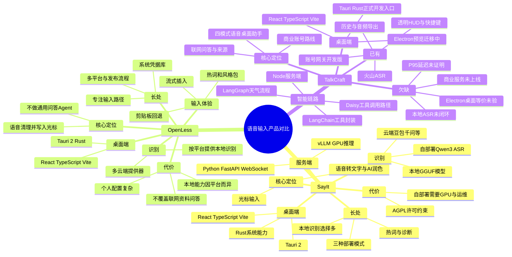

# SayIt、OpenLess 与 TalkCraft：语音输入技术与产品路线对比

> **第一次看建议先读[白话版思维导图](SAYIT-OPENLESS-TALKCRAFT-PLAIN.md)**。本文件保留技术细节和源码依据，供后续开发查阅。

> 核对日期：2026-09-29。SayIt 参考 `main` 提交 [`6e7c5e5`](https://github.com/crosswk/SayIt/tree/6e7c5e5bd6e784fa8e3cfb57e78b7ff7c06dc512)，客户端版本 0.2.2；OpenLess 参考稳定 `main` 提交 [`08d7060`](https://github.com/Open-Less/openless/tree/08d70601f993244d9be7e61e214b8973136df931)，应用版本 1.3.18。TalkCraft 以当前工作区和 2026-09-29 进度为准。三者实际响应速度、识别准确率没有在同一硬件、音频和网络条件下实测，不能直接排出高低。
>
> 阅读：支持 Mermaid 的 Markdown 阅读器可渲染下方思维导图；Markmap、XMind 等支持 Markdown 大纲导入的工具可使用紧随其后的标题层级。普通 Markdown 阅读器仍能阅读后面的对比表。

## 一、技术与产品思维导图

### 可导入思维导图软件的 Markdown 大纲

#### SayIt

##### 技术：Tauri/Rust + React/TypeScript；可选 Python/FastAPI/WebSocket/vLLM 服务器

##### 优势：本地、云 API、服务器三条识别路线；专业热词；可自部署

##### 代价：GPU 服务器运维；本地模型构建和下载；AGPL 复用约束

#### OpenLess

##### 技术：Tauri/Rust + React/TypeScript；系统级快捷键、输入和凭据管理

##### 优势：流式光标输入、回退、风格包、词典、多平台发布

##### 代价：BYOK 配置成本；本地 ASR 因平台不同；不做通用联网问答

#### TalkCraft

##### 技术：Tauri/Rust + React/TypeScript + Node.js；Electron 预览；LangChain/LangGraph 与工具调用

##### 优势：四模式、联网问答与可追溯来源、独立历史、账号网关雏形

##### 代价：本地识别和 TTS 未闭环；Electron 原生能力未等价；真实 P95 与商用后端未验

## 二、可核实的技术栈

| 维度 | SayIt | OpenLess | TalkCraft 当前状态 |
| --- | --- | --- | --- |
| 产品主要任务 | 语音转录、AI 润色与光标输入；支持选区编辑等扩展 | 语音转录、指定风格润色与光标输入；README 明确不做通用问答或长期对话 | 听写、提示词预设、翻译、问答；问答可调用联网工具并展示来源 |
| 桌面前端 | Tauri 2 + React 18 + TypeScript + Vite 6 + Tailwind 3 | Tauri 2 + React 18 + TypeScript + Vite 6 + Tailwind 4 | Tauri 2 + Rust 为唯一 Windows 开发入口；React 19 + TypeScript + Vite 7；Electron 44 仅预览壳 |
| 本地系统能力 | Rust 快捷键、窗口、粘贴、录音、本地 GGUF 模型 | Rust 快捷键、流式插入、剪贴板回退、系统凭据库 | Rust 快捷键、透明 HUD、外部输入、托盘；Electron 等价迁移尚未验收 |
| ASR | 云 API、本地 GGUF/ggml、多 GPU/CPU 模式；可选服务器 Qwen3-ASR | 多家云 ASR；macOS 内置 Qwen3-ASR 选项，Windows 本地选项含实验性实现 | 火山/豆包云端 ASR；本地 ASR 尚未形成产品闭环 |
| AI 文字 | 客户端可调用 OpenAI 兼容接口；服务器可配文字处理 | 多家云端润色提供器、风格包；重点是清理输入文字 | DeepSeek、OpenAI、方舟、Ollama；听写不走 LLM，其余模式按授权处理 |
| 服务器 | 可选 Python FastAPI + WebSocket + Qwen3-ASR/vLLM；另有小型 Node 网关 | 核心语音输入可由本机和用户自带 API 运作；风格包市场另有服务 | 本机 Node 服务；另有本机开发版账号网关与 SQLite 事务额度账本，尚非公网商用服务 |
| 联网搜索 Agent | 仓库主路径是转写/润色；未见同 TalkCraft 等价的通用检索—读页—引用问答链路 | README 明确主流程不回答用户问题；选区问答不是通用联网研究 Agent | `search_web`、`read_webpage`、`get_weather`，DeepSeek 工具调用路径、来源轨迹；天气图部分使用 LangGraph，通用流程仍有旧编排 |
| 历史和隐私 | 本地历史、音频回放、纠错；服务器模式上传行为取决于所选服务 | 本地词典、历史和系统凭据库；使用云 ASR/润色时仍向提供方发送相应内容 | 本机历史/音频可分别控制；账号模式显式选择且会上传本次音频/文本到开发网关；凭据持久化仍待完善 |
| 发行 | Windows 安装包及应用更新机制已在仓库说明 | macOS/Windows/Android 发布流程，Linux 独立原生宿主 | 唯一 Windows 开发 EXE；正式安装包仍在 Phase 4，Electron 预览不是交付版 |

依据：[SayIt 客户端依赖](https://github.com/crosswk/SayIt/blob/6e7c5e5bd6e784fa8e3cfb57e78b7ff7c06dc512/client/package.json)、[Rust 依赖](https://github.com/crosswk/SayIt/blob/6e7c5e5bd6e784fa8e3cfb57e78b7ff7c06dc512/client/src-tauri/Cargo.toml)、[服务端依赖](https://github.com/crosswk/SayIt/blob/6e7c5e5bd6e784fa8e3cfb57e78b7ff7c06dc512/server/backend/requirements.txt)；[OpenLess 前端依赖](https://github.com/Open-Less/openless/blob/08d70601f993244d9be7e61e214b8973136df931/openless-all/app/package.json)、[Rust 依赖](https://github.com/Open-Less/openless/blob/08d70601f993244d9be7e61e214b8973136df931/openless-all/app/src-tauri/Cargo.toml)；TalkCraft 的 `package.json`、`src-tauri/Cargo.toml`、`docs/AI-BACKEND.md` 与 `docs/COMMERCIAL-GATEWAY.md`。

## 三、为什么这样选型：优势与代价

### SayIt：同一客户端适配三种交付方式

本地 GGUF 适合断网和不希望上传录音的用户；云 API 适合个人按需付费；FastAPI + WebSocket + Qwen3-ASR/vLLM 服务器适合团队内网和统一推理。客户端 `LocalProvider`、`CloudAPIProvider`、`ServerProvider` 分层体现了这种设计。[实现入口](https://github.com/crosswk/SayIt/tree/6e7c5e5bd6e784fa8e3cfb57e78b7ff7c06dc512/client/src/services/transcription)

优点是用户能按隐私、硬件和成本选路线，ASR 供应商替换也较独立。代价是三条链路都要维护，服务器部署需要 GPU、CUDA、Python 依赖和并发运维；本地模型也增加下载体积与驱动兼容工作。README 的 A10G + Qwen3-ASR 延迟是**项目自身给出的特定环境数据**，不是与 TalkCraft 同条件的实测结论。[SayIt README 与测试条件](https://github.com/crosswk/SayIt/blob/6e7c5e5bd6e784fa8e3cfb57e78b7ff7c06dc512/README.zh-CN.md)

### OpenLess：把语音输入缩成一条短路径

它把重点放在热词、风格、光标插入和回退，Rust 处理系统级快捷键与输入，React 管理配置和状态。流式润色与逐字符插入旨在降低**感知等待**，不等于 ASR 或模型计算时间也下降。多家提供器和按平台本地识别提升选择空间，同时增加测试矩阵；系统凭据库和自动更新是长期桌面产品的实用基础。[项目定位和功能](https://github.com/Open-Less/openless/blob/08d70601f993244d9be7e61e214b8973136df931/README.zh.md)、[插入实现](https://github.com/Open-Less/openless/blob/08d70601f993244d9be7e61e214b8973136df931/openless-all/app/src-tauri/src/insertion.rs)

它刻意不把普通语音输入变成会回答问题的 Agent。这样更容易保证“用户说什么就输入什么”，却不能代替 TalkCraft 的天气、产品参数、网页阅读与引用链路。按仓库文档，本地 ASR 能力在 macOS 与 Windows 并不完全相同，Windows 的部分方案仍标为实验性。[OpenLess README](https://github.com/Open-Less/openless/blob/08d70601f993244d9be7e61e214b8973136df931/README.md)

### TalkCraft：语音输入与联网问答共存

TalkCraft 的价值在四模式和可追溯问答：听写只转录，提示词预设做整理，翻译做跨语言输出，问答才按授权联网。搜索、读页、天气和来源面板增加了可解释性，也增加了请求数、延迟、失败处理和预算管理复杂度。当前 Electron 只是预览迁移，Tauri 仍是唯一 Windows 开发交付入口；迁壳本身不会让 ASR 或搜索自动变快。[AI 后端状态](AI-BACKEND.md)、[Electron 迁移状态](ELECTRON-MIGRATION.md)

Phase 2 已有开发版账号、受控网关和事务额度，但尚无生产级 HTTPS 部署、邮件验证、正式套餐、支付、跨设备及真实云端对账。不能把这段开发闭环与 SayIt 的公共体验服务或成熟订阅软件画等号。[商业网关状态](COMMERCIAL-GATEWAY.md)

## 四、TalkCraft 值得借鉴什么

1. **先补 ASR 选择与测量。** 参考 SayIt 的提供器分层和单段样本延迟测试，但仍用同一组中文地名、数字、否定词与长录音比较字错率、停录到转写 P50/P95、内存和成本。是否引入本地 ASR，先测 Windows 安装体积、显卡/CPU 兼容与冷启动，再决定默认模型。
2. **缩短语音到光标的可见等待。** 参考 OpenLess 的实时状态、热词到 ASR 的传递、流式输出与失败回退；TalkCraft 的听写必须保持原文，流式 AI 插入仅用于合适模式，并验证取消时不会留下半段错误文本。
3. **保留自己的问答工具链。** 两个项目的主路径都不提供同等的通用联网搜索、网页读取、结构化天气与来源证据。继续优化工具选取、会话指代、引用支持度和有界补查，不把“润色速度”当作“问答质量”。
4. **商业服务单独建设。** SayIt 的自部署 GPU 推理适合企业方案参考，OpenLess 的系统凭据库适合桌面安全参考；TalkCraft 的订阅额度仍应由服务端鉴权、计量和支付状态决定，不能用本机历史字数扣费。
5. **保持可回退的桌面迁移。** Electron 预览要先完成快捷键、HUD、透明区域、光标输入、托盘和退出等价验收，再考虑替换当前 Tauri EXE。三者公开资料都不能证明 Electron 或 Tauri 本身决定最终语音响应时延。

## 五、许可证与证据边界

- SayIt 根目录与 `server/` 的许可证文本均为 **AGPL-3.0**。商业闭源产品若复制其代码或以修改版提供网络服务，需先进行许可证合规审查；此文仅借鉴架构思路，不建议直接搬代码。[根许可证](https://github.com/crosswk/SayIt/blob/6e7c5e5bd6e784fa8e3cfb57e78b7ff7c06dc512/LICENSE)、[服务端许可证](https://github.com/crosswk/SayIt/blob/6e7c5e5bd6e784fa8e3cfb57e78b7ff7c06dc512/server/LICENSE)
- OpenLess 此次核对的根 `LICENSE` 文本及 README 写的是 **MIT**；GitHub API 的自动 `license.spdx_id` 却返回 AGPL-3.0，元数据与仓库根文件不一致。复用前应以目标文件及其子模块、第三方依赖的具体许可证再核对，不能只看仓库徽章。[根许可证](https://github.com/Open-Less/openless/blob/08d70601f993244d9be7e61e214b8973136df931/LICENSE)
- 两个仓库的 README 是项目方对功能和性能的陈述。本文件用依赖清单与关键源码核对架构，**没有安装运行两个竞品，也没有在同条件下测量其 P95、字错率或资源占用**。TalkCraft 的真实 Windows/云端/硬件未验项仍按现有进度文档保留。
