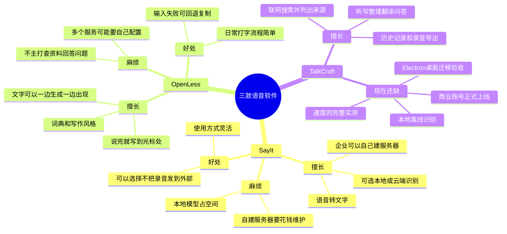

# SayIt、OpenLess 和 TalkCraft：小白也能看懂的对比

> 2026-09-29 根据三个项目当时的公开代码和 TalkCraft 当前进度整理。下面说的“快”是设计思路，不代表已经在同一台电脑上实测出谁最快。

## 先用一句话认识它们

- **SayIt**：像一位可以选择在你电脑上、云端，或公司服务器上工作的“语音打字员”。重点是把话听准，再整理成文字。
- **OpenLess**：像一副“会帮你润色的语音键盘”。重点是按快捷键说话，文字尽快出现在你正打字的地方。
- **TalkCraft**：除了语音打字，还想成为“会查资料的语音助手”。可以听写、整理、翻译、问答，并在联网问答时告诉你资料来自哪里。

## 思维导图

支持 Mermaid 的 Markdown 软件可以直接显示这张图；Markmap 等软件也可以按本文标题生成思维导图。

## 用同一个场景比较

假设你在 Word 里想说：“帮我写一封礼貌的邮件，说明交货要晚两周。”

| 软件 | 大致会怎样做 | 你会感到的优点 | 可能遇到的麻烦 |
| --- | --- | --- | --- |
| SayIt | 听到你的话，识别成文字，再按设置整理，放到光标处 | 可以选本地、自己的云接口或自建服务器；中文识别选择多 | 想自己搭服务器，需要显卡和维护；选项多，设置也更多 |
| OpenLess | 听到你的话，按选定风格润色，并尽快写到光标处 | 特别专注“说完就能继续写”；有些文字能边生成边出现 | 它主要帮你写文字，不负责像搜索助手一样查证最新资料 |
| TalkCraft | 听写时只出原话；选“提示词预设”可整理；问答模式才去回答问题 | 一套软件里有四种不同用途；联网问答还能看来源 | 功能越多，流程越复杂；速度、离线识别和商业版还需要继续打磨 |

**再换一个问题：“明天张家港天气怎么样？”** SayIt 和 OpenLess 的主任务是把这句话写出来；TalkCraft 的问答模式才会尝试查天气并回答。OpenLess 虽有针对选中文字的问答面板，但它的公开说明明确说，普通语音输入不是一个通用的联网问答助手。[SayIt 项目说明](https://github.com/crosswk/SayIt/blob/6e7c5e5bd6e784fa8e3cfb57e78b7ff7c06dc512/README.zh-CN.md) · [OpenLess 项目说明](https://github.com/Open-Less/openless/blob/08d70601f993244d9be7e61e214b8973136df931/README.zh.md)

## 两个项目有什么值得我们学？

### 从 SayIt 学：给语音识别准备不同选择

SayIt 提供三条路：

1. **本地识别**：电脑自己听，能减少对网络的依赖，但会占磁盘和电脑性能。
2. **云接口识别**：把录音送给服务商，用户不用准备高性能电脑，但需要网络和服务费用。
3. **自建服务器识别**：公司自己准备服务器给多人用，控制权更高，但要承担显卡、部署和维护成本。

TalkCraft 现在主要有云端识别。值得学习的是：以后增加本地选项，并拿同一批真实语音，比较**识别准不准、停录后等多久、要花多少钱**。SayIt 发布的速度数字是在它自己的特定显卡和样本下测得，不能直接说 TalkCraft 一定更慢。[SayIt 识别方案与测试条件](https://github.com/crosswk/SayIt/blob/6e7c5e5bd6e784fa8e3cfb57e78b7ff7c06dc512/README.zh-CN.md)

### 从 OpenLess 学：减少“说完还要等、还要点”的步骤

OpenLess 特别重视三个小细节：常用人名和专业词放进词典；文字能逐步出现在光标处；输入失败时保留一份可复制的结果。这些不会神奇地让网络变快，但能减少用户等待和丢字的感觉。[OpenLess 功能说明](https://github.com/Open-Less/openless/blob/08d70601f993244d9be7e61e214b8973136df931/README.zh.md)

TalkCraft 值得优先把**识别错的地名和术语**处理好，再优化从“结束录音”到“看见文字”的时间。对于听写，仍必须保持“说什么就写什么”；不能为了显得智能而偷偷改写原话。

## 我建议 TalkCraft 怎么走

1. **先把基础语音输入磨顺。** 用真实录音反复测张家港等地名、数字、否定词和长句；记录停录到文字出现的时间，而不是只看软件能不能运行。
2. **补词典和可选的离线识别。** 先检查 Windows 普通电脑能否流畅运行，再决定要不要提供模型下载；不要让所有用户一安装就下载几个 GB。
3. **保留我们的联网问答优势。** 语音打字与查资料是两件事。TalkCraft 回答天气、产品参数时，要查到可靠数据、显示来源，查不到就说明查不到。
4. **商业账号继续独立开发。** 当前账号网关是本机开发版，免费额度和订阅还不是正式产品。用户的付费额度最终必须由真正的服务端计算。
5. **Electron 迁移按功能验收。** 用户已决定逐步迁移，但换一个桌面框架本身并不能保证识别和联网问答更快。快捷键、悬浮窗、光标输入、退出与录音都验证通过，才适合把它换成默认版本。

## 有两个容易误解的地方

- **“能在本地运行”不等于“完全不联网”。** 只有实际选择本地识别和本地文字模型，相关内容才不必送到云端；使用云接口时，音频或文字仍会按功能发送出去。
- **“开源”不等于“代码可以直接搬来卖”。** SayIt 的许可证是 AGPL；如果想把它的代码放进商业产品，先要做授权合规核对。OpenLess 当前查看的根许可证写 MIT，但 GitHub 的自动许可证标签与根文件不一致，也应在复用前核实具体文件及第三方依赖。我们可以先借鉴思路、自己实现。[SayIt 许可证](https://github.com/crosswk/SayIt/blob/6e7c5e5bd6e784fa8e3cfb57e78b7ff7c06dc512/LICENSE) · [OpenLess 许可证](https://github.com/Open-Less/openless/blob/08d70601f993244d9be7e61e214b8973136df931/LICENSE)

想看版本号、依赖和代码依据，可再打开[技术细节版](SAYIT-OPENLESS-TALKCRAFT-COMPARISON.md)。
